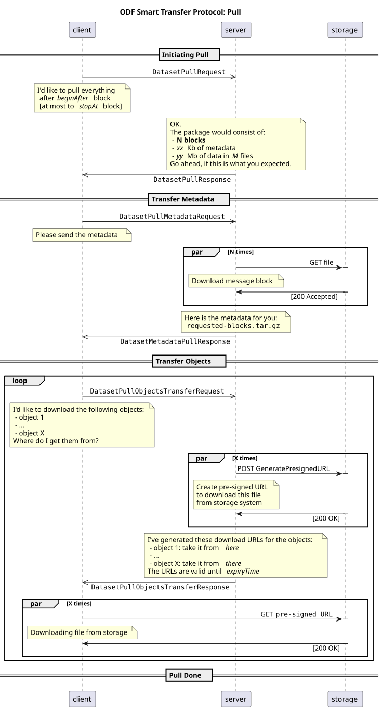
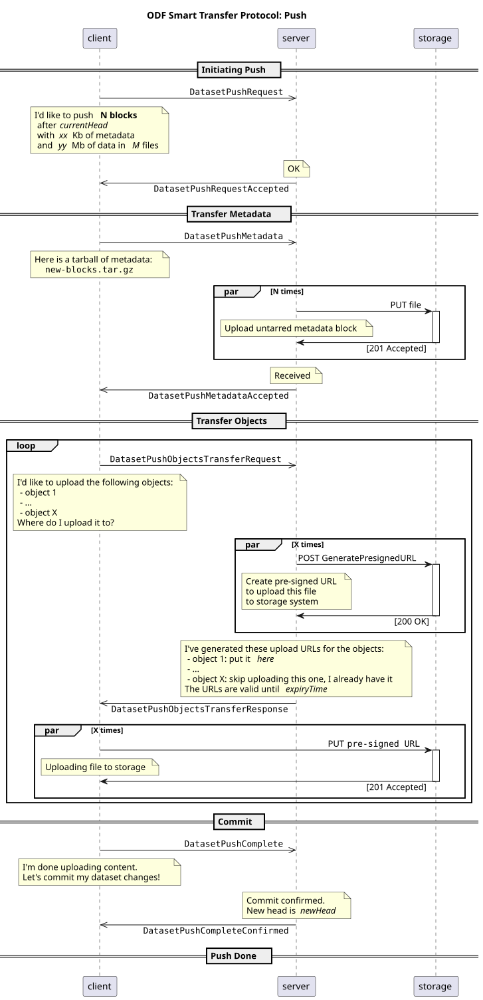

# Transfer Protocols <!-- omit in toc -->

**Domain**: Exchange
**Depends on**: [Storage Layout](../datasets/storage-layout.md)
**RFCs**: [RFC-007](../../rfcs/007-simple-transfer-protocol.md), [RFC-008](../../rfcs/008-smart-transfer-protocol.md)

## Abstract <!-- omit in toc -->

This spec defines how [Datasets](../glossary.md#dataset) are shared and synchronized between [Repositories](../glossary.md#repository). It defines the minimal read-only Simple Transfer Protocol that works on top of any storage that can read objects by key, the efficient read-write Smart Transfer Protocol that allows transferring data directly to and from the storage of a repository, and the rules that keep shared datasets consistent for concurrent readers.

## Table of Contents <!-- omit in toc -->

- [Design Goals](#design-goals)
- [Dataset Sharing](#dataset-sharing)
- [Validation of Transferred Data](#validation-of-transferred-data)
- [Simple Transfer Protocol](#simple-transfer-protocol)
- [Smart Transfer Protocol](#smart-transfer-protocol)
  - [Establishing a Session](#establishing-a-session)
  - [Pull Flow](#pull-flow)
  - [Push Flow](#push-flow)
  - [Object Transfer](#object-transfer)
  - [Error Handling](#error-handling)
  - [Messages](#messages)
- [API Definitions](#api-definitions)

## Design Goals
The guiding factors in designing how data is shared were:
- Minimal storage requirements - while a certain degree of replication is necessary to keep data highly available, we don't want to duplicate data more than it's necessary.
- Decentralization - there should be no central authority that decides what the "right data" is.
- Verifiable trust - even when data is hosted by a single party any tampering or alterations must still be impossible.
- Minimize the movement of data - when a trusted party keeps data in an environment that also provides compute resources, we would like to be able to process and query data without the need to always download it locally.

The way we designed [Metadata](../glossary.md#metadata) plays a crucial role in data sharing.

Metadata is usually several orders of magnitude smaller than the data it describes, so it's ideally suited to be widely shared. The exact way it's shared is out of scope of this document, but in most simple cases it can be published openly by the provider of data and cryptographically signed to ensure authenticity.

When the metadata of a certain dataset is reliably known, a peer can then download the data from any untrusted source and use the metadata to validate the authenticity of every data slice that composes it (see [Hash](../glossary.md#hash)) - this means that we need to only ensure the validity of metadata, while the data can be stored almost anywhere with minimal replication factor, as long as one compromised party does not result in the complete loss of data.

Metadata also provides us with a way to establish the trustworthiness of any dataset by reviewing the transformations declared in it, re-applying those transformations in a trusted environment, and comparing the results to the original data. In a distributed system, having peers cross-validate each other's published data can guarantee trusted results and allow them to promptly identify and exclude malicious peers from the network.

## Dataset Sharing
Dataset sharing involves uploading the data to some [Repository](../glossary.md#repository) where it can be discovered and accessed by other peers. Due to immutable nature of data and metadata it is very easy to keep shared data up-to-date as only new blocks and part files need to be uploaded.

It is important to ensure the atomicity of the sharing, or at least create the perception of atomicity to someone who happens to be downloading the data concurrently with the upload.

For [Repositories](../glossary.md#repository) that do not support atomic file/object operations the following sequence of operations can ensure that concurrent downloads will always see the [Dataset](../glossary.md#dataset) in a consistent state:
1. Upload data part files and checkpoints
2. Upload metadata blocks
3. Update references in the `refs` section (see [Storage Layout](../datasets/storage-layout.md#dataset-components))

## Validation of Transferred Data
Repositories, storage systems, and peers that data is transferred from are not trusted. Regardless of the transfer protocol used, the receiving party must validate all received objects before committing them:
- Metadata blocks are validated according to [Metadata Chain: Validation](../datasets/metadata-chain.md#validation), and must form a valid continuation of the chain the receiver already has
- Data part files and checkpoints are validated against the physical hashes stored in metadata (see [Data & Checkpoint Hashing: Verification](../datasets/data-and-checkpoint-hashing.md#verification))
- Block references are updated only after all objects they make reachable were received and validated

This applies both to clients pulling data, and to servers accepting data pushed to them. The trust in the transferred dataset is therefore reduced to the trust in the hash of its last block.

## Simple Transfer Protocol
Simple Transfer Protocol is a bare-minimum read-only protocol used for synchronizing [Datasets](../glossary.md#dataset) between [Repositories](../glossary.md#repository). It requires no ODF-specific logic on the server side and can be easily implemented, for example, by serving a dataset directory under an HTTP server. It's designed for maximal interoperability, not for efficiency.

The only operation a server needs to support is **reading an object by key**. The protocol purposefully does not rely on any advanced features like the ability to list a directory, so a dataset can be served from any storage that uses the [layout of file systems and object stores](../datasets/storage-layout.md#layout-in-file-systems-and-object-stores), including content-addressable storage networks that provide HTTP gateways.

To describe the protocol we will use HTTP `GET {object-key}` notation below, but note that this protocol can be implemented on top of any block or file-based protocol that supports Unix path-like object keys.

1) Process begins with `GET /refs/head` to get the hash of the last [Metadata Block](../glossary.md#metadata-chain)
2) The "metadata walking" process starts with `GET /blocks/{blockHash}` and continues following the `prevBlockHash` links
3) Data part files can be downloaded by using [`DataSlice::physicalHash`](../../schemas/datasets/v1alpha1/DataSlice.json) links with `GET /data/{physicalHash}`
4) Checkpoints are similarly downloaded using [`Checkpoint::physicalHash`](../../schemas/datasets/v1alpha1/Checkpoint.json) links with `GET /checkpoints/{physicalHash}`
5) The process continues until reaching the first block of the dataset or other termination condition (e.g. reaching the block that has already been synced previously)

`DataSlice` and `Checkpoint` objects also carry the `size` of the files, which can be used as a size hint when transferring files between repositories in a streaming fashion.

## Smart Transfer Protocol
Smart Transfer Protocol is a superset of the [Simple Transfer Protocol](#simple-transfer-protocol), which allows both reads and writes and solves performance issues to allow efficient synchronization between remote dataset repositories:
- Metadata blocks are transferred in batches as archives instead of one at a time
- Object files (data part files and checkpoints) are transferred directly to and from the storage system of the repository, with unrestricted degree of parallelism, instead of being proxied through the server

The protocol assumes establishing a duplex asynchronous communication channel between the parties. A separate session of message exchanges is open for a single pull or push operation, and it is closed after the operation is complete or fails with an error.

The protocol can be implemented using [WebSockets](https://websockets.spec.whatwg.org/) or any other type of channel that supports bi-directional non-blocking message exchanges.

### Establishing a Session
In addition to the HTTP endpoints of the Simple Transfer Protocol, servers implementing the Smart Transfer Protocol provide two more endpoints:
1) `GET /pull` - to start the smart pull flow on the dataset
2) `GET /push` - to start the smart push flow on the dataset

Both endpoints switch from HTTP to the WebSocket protocol using the standard [upgrade mechanism](https://datatracker.ietf.org/doc/html/rfc6455#section-4), where:
- `Sec-WebSocket-Protocol` header is set to `odf/smart-transfer-protocol/v1`
- `x-odf-smtp-version` header specifies the version of the Smart Transfer Protocol the client wants to use

All endpoints and messages are authorized using a bearer access token.

### Pull Flow
1. Client sends `DatasetPullRequest` with the dataset ID and the desired block range: `beginAfter` - the last block the client already has (absent for the initial pull), and `stopAt` - the last block the client wants to pull (absent for `head`)
2. Server responds with `DatasetPullResponse` containing the size estimation of the transfer (number of blocks and objects and their raw sizes)
3. Client sends `DatasetPullMetadataRequest`, and the server responds with `DatasetMetadataPullResponse` containing an archive of all metadata blocks in the requested range
4. Client analyzes the received blocks and identifies missing object files
5. Client sends one or more `DatasetPullObjectsTransferRequest` messages listing a subset or the full set of missing object files, and the server responds to each with `DatasetPullObjectsTransferResponse` containing the download strategy for every object (a time-limited download URL with read-only access to the storage system)
6. Client downloads the object files directly from the storage system
7. Client commits the new blocks locally and closes the session

### Push Flow
1. Client sends `DatasetPushRequest` with the dataset ID, the `currentHead` that the client assumes to be the current head on the server, and the size estimation of the transfer
2. Server responds with `DatasetPushRequestAccepted`
3. Client sends `DatasetPushMetadata` containing an archive of the new metadata blocks, and the server responds with `DatasetPushMetadataAccepted` if it does not detect a divergence in the metadata
4. Client sends one or more `DatasetPushObjectsTransferRequest` messages listing a subset or the full set of new object files, and the server responds to each with `DatasetPushObjectsTransferResponse` containing the upload strategy for every object: a time-limited upload URL with write-only access to the storage system, or an instruction to skip the upload of an object that the server already has
5. Client uploads the object files directly to the storage system
6. Client sends `DatasetPushComplete`
7. Server verifies that the required objects exist and attempts to commit the new metadata blocks
8. In case of success, server responds with `DatasetPushCompleteConfirmed` and closes the session

### Object Transfer
Object files are transferred out-of-band, directly between the client and the storage system of the repository, using pre-signed URLs:
- The exchange of object files should be performed with delays and object sizes taken into account. As the expiration time of pre-signed URLs is limited, when large bulks of objects have to be exchanged the URLs may expire before the actual transfer starts - in this case they need to be re-requested.
- The parallelism of downloads and uploads is not limited by the protocol and is not to be constrained by the server - it's an implementation detail of the client.

### Error Handling
Errors that happen during any operation are reported by the server with the `DatasetError` message that carries an error code, a description, and optional extra fields.

In case of errors and timeouts the client needs to re-initiate the operation by opening another session. A new operation may skip the transfer of object files that were already processed in previous sessions, even if the changes have not been committed to the metadata.

Object files that were uploaded during failed operations remain orphaned in the storage until removed by a garbage collection mechanism, which is out of scope of this spec.

### Messages

| Message | Direction | Description |
| --- | --- | --- |
| `DatasetPullRequest` | Client → Server | Initiates a pull of a block range |
| `DatasetPullResponse` | Server → Client | Accepts the pull and provides size estimation |
| `DatasetPullMetadataRequest` | Client → Server | Requests the metadata blocks |
| `DatasetMetadataPullResponse` | Server → Client | Archive of the requested metadata blocks |
| `DatasetPullObjectsTransferRequest` | Client → Server | Requests download strategies for a set of object files |
| `DatasetPullObjectsTransferResponse` | Server → Client | Download strategies for the requested object files |
| `DatasetPushRequest` | Client → Server | Initiates a push with the expected current head |
| `DatasetPushRequestAccepted` | Server → Client | Accepts the push |
| `DatasetPushMetadata` | Client → Server | Archive of the new metadata blocks |
| `DatasetPushMetadataAccepted` | Server → Client | Accepts the new metadata blocks |
| `DatasetPushObjectsTransferRequest` | Client → Server | Requests upload strategies for a set of object files |
| `DatasetPushObjectsTransferResponse` | Server → Client | Upload strategies for the requested object files |
| `DatasetPushComplete` | Client → Server | Informs that all objects were uploaded |
| `DatasetPushCompleteConfirmed` | Server → Client | Confirms the commit of the new blocks |
| `DatasetError` | Server → Client | Reports an error that happened during the operation |

## API Definitions
- [Smart Transfer Protocol: OpenAPI](../../contracts/transfer/smart-transfer-protocol.openapi.yaml) - HTTP endpoints of the Simple and Smart Transfer Protocols
- [Smart Transfer Protocol: AsyncAPI](../../contracts/transfer/smart-transfer-protocol.asyncapi.yaml) - asynchronous messages of the Smart Transfer Protocol
