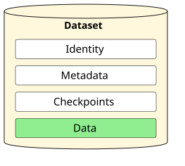
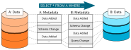
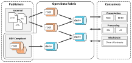
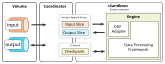
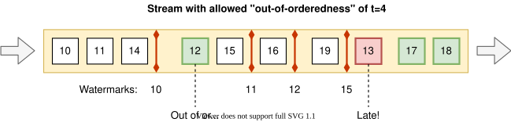
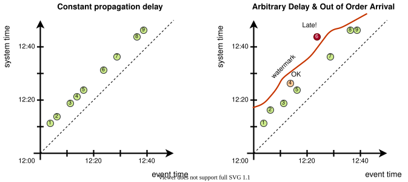

# Glossary <!-- omit in toc -->

Definitions of core concepts and terms shared by all ODF specs.


## Table of Contents <!-- omit in toc -->

- [Account](#account)
- [Checkpoint](#checkpoint)
- [Coordinator](#coordinator)
- [Data](#data)
- [Data Slice](#data-slice)
- [Dataset](#dataset)
  - [Root Dataset](#root-dataset)
  - [Derivative Dataset](#derivative-dataset)
- [Engine](#engine)
- [Entity](#entity)
- [Event](#event)
- [Hash](#hash)
- [Ingestion](#ingestion)
- [Manifest](#manifest)
- [Merge Strategy](#merge-strategy)
- [Metadata](#metadata)
- [Metadata Chain](#metadata-chain)
- [Node](#node)
- [Offset](#offset)
- [Operation Type](#operation-type)
- [Principal](#principal)
- [Projection](#projection)
- [Provenance](#provenance)
- [Query](#query)
- [Repository](#repository)
- [Resource](#resource)
- [Retractions and Corrections](#retractions-and-corrections)
- [Schema](#schema)
- [Time](#time)
  - [System Time](#system-time)
  - [Event Time](#event-time)
- [Verifiability](#verifiability)
- [Watermark](#watermark)


## Account
A named identity within a [Node](#node) that can own [Resources](#resource) or act as a [Principal](#principal). Accounts can be users, organizations, service accounts, or the node itself.

Every resource belongs to an account, making accounts the unit of multi-tenancy - resources of the same type and name can exist under different accounts.

See also:
- [Authorization: Accounts](auth-and-privacy/authorization.md#accounts)
- [Resource Framework: Ownership](automation/resource-framework.md#ownership)


## Checkpoint
Checkpoints are used by the [Engines](#engine) to store the computation state between the different invocations of a [Query](#query). They are fully engine-specific and opaque to the system. They are however an essential durable part of a [Dataset](#dataset) as they are necessary to be able to pause and resume the streaming queries, and are essential in implementing "exactly-once" processing semantics.


## Coordinator
Coordinator is an application that implements the common [Dataset](#dataset) management logic.

Core responsibilities:
- Handles all [Metadata Chain](#metadata-chain) operations
- Splits the transformation work into batches based on the dataset's evolution timeline
- Collects relevant data slices of the input datasets
- Delegates data processing to the [Engines](#engine), making all transformations look to them as conventional stream processing
- Commits the resulting data slices and new metadata blocks

See also:
- [Coordinator Contract](../open-data-fabric.md#coordinator-contract)


## Data
Data is a set of [Events](#event) stored in the system. Since events are immutable data can only grow over time. Conceptually it's best to think of data as a full log of a potentially infinite event stream.

Data never appears in the system alone as we would not be able to tell where it came from and whether it can be trusted. Data always appears as part of a [Dataset](#dataset).



See also:
- [Data Model](datasets/data-model.md)
- [Common Data Schema](datasets/data-model.md#common-data-schema)


## Data Slice
[Data](#data) arrives into the system as the arbitrary large sets of events. We refer to them as "slices".

More formally, a slice is a:
- Continuous part of [Data](#data)
- That has the same [Schema](#schema)
- Defined by its `[start; end]` [Offset](#offset) interval




## Dataset
Dataset is the main unit of data exchange in the system. It's simply a combination of:
- [Identity](datasets/identity.md)
- [Data](#data)
- [Metadata Chain](#metadata-chain)
- [Checkpoints](#checkpoint)

Depending on where the data comes from datasets can be of these kinds:
- [Root](#root-dataset)
- [Derivative](#derivative-dataset)




### Root Dataset
Root datasets are the points of entry of external data into the system. They are usually owned by the organization that has full authority and responsibility over that data, i.e. a trusted source.

Data gets into root datasets via [Ingestion](#ingestion) from sources that are defined separately from the dataset as `Source` [Resources](#resource). A source definition includes:
- Where to fetch the data from - e.g. source URL, a protocol to use, cache control
- How to prepare the binary data - e.g. decompression, file filtering, format conversions
- How to interpret the data - e.g. data format, schema to apply, error handling
- How to combine data ingested in the past with the new data - e.g. append as log or diff as a snapshot of the current state

Source definitions are not part of the [Metadata Chain](#metadata-chain), as they don't contribute to provenance or validity of data, and may reveal sensitive information about the infrastructure of a publisher. The metadata chain records the outcome of every ingestion, including the data, its schema, and the state of the source needed to resume ingestion.

See also:
- [Ingestion](datasets/ingestion.md)
- [Merge Strategy](datasets/ingestion.md#merge-strategies)


### Derivative Dataset
Derivative datasets are created by transforming/combining one or multiple existing datasets.

They are defined by the combination of:
- Input datasets
- A [Query](#query) to apply to those
- An [Engine](#engine) used to execute the query

This information is stored in the [Metadata Chain](#metadata-chain) and can change over time as the dataset evolves.

See also:
- [Processing Model](transformations/processing-model.md)
- [Derivative Data Transience](transformations/processing-model.md#derivative-data-transience)


## Engine
Engine is an interface shared by all specific implementations of a [Query](#query) dialect. Engine implementations are responsible for applying defined queries to input data and returning the result. For example, some engines allows you to query data using a series of streaming SQL statements.

Engines run in a sandboxed environments and are not permitted to use any external resources to guarantee the reproducibility of all operations.



As Engines are in the full control of all data transformations, they are also responsible for answering the [Provenance](#provenance) queries.

See also:
- [Engine Contract](transformations/engine-contract.md)


## Entity
A data plane object materialized from a [Resource](#resource) to fulfill its desired state, e.g. an ODF [Dataset](#dataset) stored in an S3 bucket, a secret, or an encryption key.

Entities are separate from the resources that describe them. For example, when a dataset is replicated between two nodes, each node has its own `Dataset` resource with a different ID, while both describe the same dataset entity with the same DID.

See also:
- [Resource Framework: Resources and Entities](automation/resource-framework.md#resources-and-entities)


## Event
As described in the [Nature of Data](../open-data-fabric.md#nature-of-data) section, the system operates only on data expressed as past events, observations, or propositions believed to be true at a certain time. For simplicity, we will use the term "event" throughout to refer to such data tuples.


## Hash
[Cryptographic hash functions](https://en.wikipedia.org/wiki/Cryptographic_hash_function) are used by the system in these three scenarios:
- Computing a logical hash sum of a [Data Slice](#data-slice).
- Computing a physical hash sum of a [Data Slice](#data-slice).
- Computing a hash sum of a [MetadataBlock](#metadata-chain).

Whenever new events are appended to the [Data](#data) the [Metadata Chain](#metadata-chain) will also be extended with a block containing a hash sum of the new data slice. The hash sum provides a very quick and reliable way to later validate that the data matches the one that has been written earlier.

The new [MetadataBlock](#metadata-chain) will also be cryptographically signed to guarantee its integrity - this excludes any malicious or accidental alterations to the block.

Usage examples:
- If the [Metadata Chain](#metadata-chain) of a certain dataset is reliably known (e.g. available from many independent peers) a peer can then download the [Data](#data) from any untrusted source and use the hash function to validate the authenticity of every data slice that composes it.
- The trustworthiness of any [Dataset](#dataset) can be established by reviewing the transformations it claims to be performing on data (contained in the [Metadata Chain](#metadata-chain)), re-applying those transformations in a trusted environment, and then comparing the hash sums of the result slices.

See also:
- [Data Hashing](datasets/data-and-checkpoint-hashing.md#physical-and-logical-hashes)
- [Checkpoint Hashing](datasets/data-and-checkpoint-hashing.md#checkpoint-hashing)
- [Metadata Block Hashing](datasets/metadata-chain.md#metadata-block-hashing)


## Ingestion
Ingestion is the process by which external data gets into the system. Typical ingestion steps that describe how data is obtained and read (e.g. fetching data from some URL on the web, decompressing it, and reading it as CSV) are defined by `Source` [Resources](#resource), and the ingested data is added to [Root Datasets](#root-dataset).

See also:
- [Ingestion](datasets/ingestion.md)


## Manifest
A declarative configuration (e.g. a YAML file) that describes the desired state of a [Resource](#resource). Applying a manifest to a [Node](#node) creates or updates the corresponding resource, after which controllers reconcile the actual state of the system with the desired state.

```yaml
$schema: https://opendatafabric.org/schemas/config/v1alpha1/SecretSet
headers:
  name: my-secrets
spec: {}
```

> **Note:** Earlier versions of the spec used the term for the legacy [`Manifest`](../schemas/legacy/v0/Manifest.json) wrapper of metadata objects (e.g. `DatasetSnapshot`) that is now deprecated.

See also:
- [Resource Framework: Resource Manifests](automation/resource-framework.md#resource-manifests)


## Merge Strategy
By [design](../open-data-fabric.md#nature-of-data), the system only stores data in the append-only event log format to preserve the entire history. Unfortunately, a lot of data in the world is not stored or exposed this way. Some organizations may expose their data in the form of periodic database dumps, while some choose to provide it as a log of changes between current and the previous export.

When [ingesting data](#ingestion) from external sources, the [Root Datasets](#root-dataset) can choose between different [Merge Strategies](datasets/ingestion.md#merge-strategies) that define how to combine the newly-ingested data with the existing one.

For example, when dealing with the daily database dumps, a user can choose the merge strategy that performs [change data capture](https://en.wikipedia.org/wiki/Change_data_capture), transforming dumps into a set of events that signify record creation, update, or deletion.

See also:
- [Merge Strategies](datasets/ingestion.md#merge-strategies)


## Metadata
Refers to information about a [Dataset](#dataset) stored in its [Metadata Chain](#metadata-chain).


## Metadata Chain
Metadata Chain is an append-only log of **Metadata Blocks** that captures the entire history of a [Dataset](#dataset): its identity, [Schema](#schema), what data was added and when, how it was processed (see [Query](#query)), and other information like licenses and descriptions.

Every block carries one metadata event and refers to the [hash](#hash) of the previous block, so having a reference to the last block one can traverse the entire chain and discover and verify all components of the dataset.

See also:
- [Metadata Chain](datasets/metadata-chain.md)


## Node
An entire ODF deployment acting under a single identity. A node hosts [Datasets](#dataset) and other [Resources](#resource) belonging to one or many [Accounts](#account), manages them using the [Coordinator](#coordinator) logic, and exposes them to other participants via [Repository](#repository) and query protocols.

A node also acts as a [Principal](#principal) in system tasks and node-to-node communications.

See also:
- [Authorization: Node](auth-and-privacy/authorization.md#node)


## Offset
Offset is a monotonically increasing sequential numeric identifier that is assigned to every record and represents its position relative to the beginning of the dataset. Offsets are used to uniquely identify any record in the dataset. Offset of the first record in a dataset is `0`.


## Operation Type
Since past [Events](#event) are immutable, if some event is deemed incorrect later on it can only be rectified by issuing an explicit [retraction or correction](#retractions-and-corrections). Retraction and corrections are also represented as [Events](#event) in the same stream of [Data](#data) and differentiated by a special "operation type" field.

See also:
- [Common data schema](datasets/data-model.md#common-data-schema)
- [Representation of retractions and corrections](datasets/data-model.md#representation-of-retractions-and-corrections)


## Principal
The identity performing an action, established through authentication: a user, a service account, a [Node](#node), or an anonymous caller. Principals are the parties whose permissions are checked during authorization, and are recorded as initiators of operations (e.g. the identity a scheduled flow runs as).

See also:
- [Authorization: Principals](auth-and-privacy/authorization.md#principals)


## Projection
In relational algebra, a [projection](https://en.wikipedia.org/wiki/Projection_(relational_algebra)) is an operation that removes one or many dimensions from a data tuple. In the context of our system the most common projections are *temporal projections* involving the [System Time](#system-time) and [Event Time](#event-time) dimensions.

Depending on the time axis, we arrive at two most important types of projections in [bitemporal data modelling](https://en.wikipedia.org/wiki/Bitemporal_Modeling):
- **AS AT** or *"As we knew at that time"*. This projection collapses the system time dimension and shows us what the state of the data was at that time to the best knowledge of the system.
- **AS OF** or *“As we should've known at the time”*. This projection collapses the event time dimension and shows us what **should've happened** at that time if we knew about all potential corrections and compensating events that were added since then.

Understanding the difference between these projections is essential when working with time series data and for achieving the reproducibility of results.

See also:
- [A Brief History of Time in Data Modelling: OLAP Systems](https://www.kamu.dev/blog/a-brief-history-of-time-in-data-modelling-olap-systems/)


## Provenance
Data provenance describes the origins and the history of data and adds value to data by explaining how it was obtained.

[Metadata Chain](#metadata-chain) alone can already significantly narrow down the search space when you want to explain how a certain piece of data came to be, as it keeps track of all the inputs and queries used to create a dataset. But the goal of the provenance system is to make this type of inquiry effortless.

We differentiate the following kinds of provenance:
- **Why-provenance** - tells us which input data elements were inspected to decide that an element should be present in the output at all - i.e. defines a sufficient set of elements needed to produce the output.
- **How-provenance** - tells us the process by which the elements of *why-provenance* caused the output to appear
- **Where-provenance** - narrows down *why-provenance* to input data elements that were copied or transformed to determine the output element value.

Since the [Engines](#engine) are responsible for all data transformations, it's also the Engine's responsibility to answer provenance queries.

There are many different ways to implement provenance:
- By statically analyzing the queries
- By inverting transformations
- By repeating the computations and logging the data used at every step
- By propagating provenance data through all computations

Depending on the language used by an [Engine](#engine) one approach may work better in one situation than the other, so we avoid prescribing the exact method to use but instead standardize the language used for provenance-related queries and responses.

See also:
- [Provenance in Databases: Why, How, and Where](http://homepages.inf.ed.ac.uk/jcheney/publications/provdbsurvey.pdf)
- [Engine Contract: Derive Provenance](transformations/engine-contract.md#derive-provenance)


## Query
Queries define how input data is combined, modified, and re-shaped to produce new data.

Queries are used in two contexts:
- When defining new [Derivative Datasets](#derivative-dataset)
- When analyzing and extracting data from an existing [Dataset](#dataset) (locally or from a [repository](#repository))

The system is agnostic to the exact language used to define the query and the set of supported dialects can be extended by implementing a new [Engine](#engine).

All queries, however, must have the following properties:
- Deterministic
- Pure
- Stream/Batch agnostic

In other words, they should be guaranteed to always produce the same result for the same input data, without side effects.

Example windowed aggregation query in streaming SQL:

```sql
SELECT
  TUMBLE_ROWTIME(event_time, INTERVAL '1' MONTH) as event_time,
  sku_id,
  min(price) as min_monthly_price,
  max(price) as max_monthly_price,
  avg(price) as avg_monthly_price
FROM sku_prices
GROUP BY TUMBLE(event_time, INTERVAL '1' MONTH), sku_id
```

See also:
- [Stream Processing Model](transformations/processing-model.md#stream-processing-model)
- [Derivative Data Transience](transformations/processing-model.md#derivative-data-transience)
- [Engine Contract](transformations/engine-contract.md)


## Repository
Repositories let participants of the system exchange [Datasets](#dataset) with one another.

Repository definition includes:
- Location where the repository can be reached (URL)
- Protocols that it supports
- Credentials needed to access it
- Any necessary protocol-specific configuration

In the most basic form, a [Repository](#repository) can simply be a location where the dataset files are hosted over one of the file or object-based data [transfer protocols](exchange/transfer-protocols.md). The owner of a dataset will have push privileges to this location, while other participants can pull data from it.

An advanced repository can support more functionality like:
- Push data API for publishers
- Subscription API for consumers
- Query API for making use of repository's compute resources and reducing the amount of transferred data

See also:
- [Transfer Protocols](exchange/transfer-protocols.md)


## Resource
A managed object of a [Node](#node) that has an identity and whose desired state is described declaratively in a [Manifest](#manifest), e.g. `Dataset`, `SecretSet`, `Flow`, or `User`. Resources form the control plane of the system - controllers continuously reconcile the actual state with the desired state, materializing resources into [Entities](#entity) in the data plane.

A resource manifest consists of:
- `$schema` - URI of the JSON schema that identifies the resource type
- `headers` - identity and ownership information, labels, and annotations
- `spec` - the desired state
- `status` - the current state and progress of reconciliation, maintained by the node

A resource is identified by its type, owning [Account](#account), and name, and is assigned a stable ID by the node upon creation.

See also:
- [Resource Framework](automation/resource-framework.md)


## Retractions and Corrections
Errors in source data are inevitable and require a mechanism for correcting them. Unlike databases, where one could issue `DELETE` or `UPDATE` queries, ODF's core data model is an immutable append-only stream, and thus requires a different mechanism.

Retractions and corrections are explicit events that can appear in [Root](#root-dataset) datasets to signify that some previous event was published in error, or to correct some of its fields. They are differentiated from regular events by the special [Operation Type](#operation-type) field.

Retractions and corrections can also naturally occur in [Derivative](#derivative-dataset) datasets in cases when a stream processing operation encounters late data (data arriving past the current [Watermark](#watermark)). In such cases streaming transformation may publish corrections or retractions for previously produced result records that were influenced by the late events.

Retractions and corrections model is fundamental to making data processing **maximally autonomous**.

See also:
- [Common data schema](datasets/data-model.md#common-data-schema)
- [Representation of retractions and corrections](datasets/data-model.md#representation-of-retractions-and-corrections)


## Schema
Schema describes the shape of the [data](#data) by associating names and data types to columns that data is composed of. Schema can change over time and its changes are tracked in the [Metadata Chain](#metadata-chain).

Example:
```
registration_time TIMESTAMP(3),
registration_id UUID,
email STRING,
first_name STRING,
last_name STRING,
date_of_birth DATE,
```

See also:
- [Schema Format](datasets/data-schema.md#schema-format)
- [Schema Evolution](datasets/data-model.md#schema-evolution)


## Time
The system applies the idea of [bitemporal data modelling](https://en.wikipedia.org/wiki/Bitemporal_Modeling) to the event streams. It differentiates two kinds of time:
- [System time](#system-time) - tells us when some event was observed by the system
- [Event time](#event-time) - tells when some event occurred from the perspective of the outside world

Every record in the system has exactly one system time associated with it upon the ingestion but can have zero to many event times.


### System Time
System time gives us a reference point for when something has occurred from the perspective of the system.

[Projecting](#projection) the data onto the system time axis answers the question: *"what did the system know at the time T?"*, meaning that such projections effectively freeze data in time, providing the natural way to achieve **reproducibility**.

For all intents and purposes system time is treated as **ordered monotonically non-decreasing value** that lets us establish a *before-after* relationship between certain events. Note, however, that *before-after* relationship is only meaningful for data within one [Dataset](#dataset) and its upstream dependencies. System time cannot be used to establish an exact *before-after* relationship between the events of the independent datasets.


### Event Time
Event time tells us when something happened from the outside world's perspective. This time, therefore, is usually the most useful one for querying and joining data.

There are no restrictions on the event time in the system - there can be many event times associated with any record, and unlike system time, event times don't have to be monotonic. This allows the system to support many kinds and varieties of event time use, like:
- Post-dated events and predictions - with event time set into the future
- Back-dated events and corrections - with event time set into the past

Depending on the type of transformations these restrictions may be more strict, e.g. joining datasets based on event time may require it to be quasi-monotonic increasing to know when the join operation can be considered complete (see [Watermarks](#watermark)).

See also:
* [Projections](#projection)
* [Watermarks](#watermark)
* [Streaming 101 by Tyler Akidau](https://www.oreilly.com/radar/the-world-beyond-batch-streaming-101/)
* [The Dataflow Model  by Tyler Akidau et al](https://static.googleusercontent.com/media/research.google.com/en//pubs/archive/43864.pdf)


## Verifiability
In the scope of this specification, verifiability of data means the ability to establish:
- The ultimate source(s) of data:
  - Which [Root Datasets](#root-dataset) the data is coming from
  - Who these datasets belong to (ownership)
  - And which actor has added the specific records (accountability)
- The transformations performed to create this data:
  - The graph of [Derivative Datasets](#derivative-dataset) upstream to the one being verified
  - Authorship of those datasets (accountability)
- And finally, that the data in fact corresponds to performing declared transformations on the source data.

In other words, having root datasets `A`, `B` and a derivative dataset `C = f(A, B)`:
- The data in `A` (and similarly in `B`) is verifiable if:
  - [Metadata Chain](#metadata-chain) of `A` is valid
    - Metadata block hashes are valid, forming a valid chain
    - Blocks point to [Data Slices](#data-slice) and [Checkpoints](#checkpoint) with valid hashes
- The data in `C` is verifiable if:
  - [Metadata Chain](#metadata-chain) of `C` is valid
  - Data in `C` corresponds to applying `f(A, B)` according to all transformation steps declared in the [Metadata Chain](#metadata-chain).

The last step of ensuring that `f(A, B) = C` can be achieved by several means:
- Reproducibility - by applying same transformations and comparing the results
- Verifiable computing - different types of proofs that can attest to validity of results without redoing the computations.

Examples of verifiable computing can include:
- [Trusted Execution Environments](https://en.wikipedia.org/wiki/Trusted_execution_environment) (TEEs)
- [Non-interactive Proofs](https://en.wikipedia.org/wiki/Non-interactive_zero-knowledge_proof) (including "zero-knowledge").

Verifiability should not be confused with *trustworthiness* or *reality* of data. Verifying a dataset doesn't prove that the data in it is either truthful or more "real" than other data. The value of verifiability comes from establishing the provenance of data so that:
- One could understand whether data is coming from reputable sources - sources they can trust (attribution)
- One could review all derivative transformations applied to the data by intermediate actors (auditability).

Verifiability provides the foundation upon which *trust* in data can be built:
- First in the form **authority** - organizations putting their name behind the data they publish
- Secondly in the form of **reputation** - trusting the sources or pipelines used by large parts of the community
- Thirdly in the form of **cross-validation** - e.g. performing outlier detection on data from several similar publishers to establish common truth.


## Watermark
A watermark defines the point in [Event Time](#event-time) for which with a high probability we've already observed all preceding events.



When performing time-based windowed operation, aggregations, or joins it is important to know when a certain time window can be considered closed. Watermark tells the system "You most likely will not get event with time less than `T` anymore".

In the [Root Dataset](#root-dataset) events can still arrive even after their time interval has been already been closed by the watermark. Such events are considered "late" and it's up to the individual [Queries](#query) to decide how to handle them. They can be simply ignored, emitted into a side output, or still considered by emitting the "correction" event into the output.

Watermarks in the system are defined per every [Metadata Block](#metadata-chain). By default, the [Root Dataset](#root-dataset) will assign the watermark to the maximum observed [Event Time](#event-time) in the [Data Slice](#data-slice). You can and should override this behavior if you expect events to arrive out-of-order to some degree, e.g. offsetting the watermark by `1 day` prior to last seen event.



Watermarks can also be set based on the [System Time](#system-time) manually or semi-automatically. This is valuable for the slow moving [Datasets](#dataset) where it's normal not to see any events in days or even months. Setting the watermark explicitly allows all computations based on such stream to proceed, knowing that there were no events for that time period, where otherwise the output would be stalled assuming the [Dataset](#dataset) was not updated for a while and old data can still arrive.
