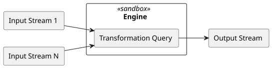

# Open Data Fabric Overview <!-- omit in toc -->

**Domain**: -
**Depends on**: -
**RFCs**: [RFC-021](../rfcs/021-spec-restructuring.md)

## Abstract

**Open Data Fabric** is an open protocol specification for decentralized exchange and transformation of semi-structured data that aims to holistically address many shortcomings of the modern data management systems and workflows.

## Table of Contents <!-- omit in toc -->

- [Problem Statement](#problem-statement)
- [Requirements](#requirements)
- [Scope](#scope)
- [Design Decisions](#design-decisions)
  - [Nature of Data](#nature-of-data)
  - [Nature of Transformations](#nature-of-transformations)
    - [Components of Trust](#components-of-trust)
    - [Verification](#verification)
  - [Stream Processing Model](#stream-processing-model)
  - [Essential Role of Metadata](#essential-role-of-metadata)
  - [Transactional Semantics](#transactional-semantics)
- [Components](#components)
  - [Coordinator](#coordinator)
  - [Engine](#engine)
  - [Node](#node)
- [Specs](#specs)

## Problem Statement
Develop a method of semi-structured data exchange that would:
- Enable worldwide collaboration around data cleaning, enrichment, and transformation.
- Create an environment of verifiable trust between participants without the need for a central authority.
- Enable a high degree of data reuse, making quality data more readily available.
- Reduce the time it takes data to propagate from publishers to consumers.
- Introduce a feedback loop between the consumers and publishers of data that would facilitate improvements around data availability, recency, and design.
- Provide foundation for implementing data anonymization techniques to simplify and speed up the exchange of vital but sensitive data.

## Requirements
Functional:
- **Complete historical account** - when data is used to gain insight and to drive decision-making discarding or modifying data is akin to rewriting history. The history of all data observed by the system must be preserved.
- **Reproducibility** - the ability to reproduce the results is a cornerstone of the scientific method without which the process and findings of one party cannot be verified by others. Therefore, we require that all the transformations performed within the system must be fully reproducible, and it must be possible to get a reference to data that is frozen in time and never changes to achieve reproducibility of any process that uses it.
- **Verifiability** - any party that plans to use some data must be able to verify its validity.
- **Provenance** - regardless of how many transformation stages the data went through, it should be possible to trace any individual data cell back to its ultimate source and understand which data contributed to its existence and its value.
- **Privacy** - sensitive data must be exchangeable and usable in computations without being disclosed to unauthorized parties. Owners of data must stay in control over who can access it, while the above requirements of verifiability and provenance must still be satisfied.

Non-Functional:
- **Transparency** - the method itself should be developed in the open, easy to understand, and reason about.
- **Timeliness** - the method should aim to minimize the propagation time of data through the transformation pipeline. The frequency with which data is presented to consumers should be optimized for their experience and usability, not dictated by limitations of the data pipeline.
- **Transactionality** - once data is in the system all operations should have [ACID properties](https://en.wikipedia.org/wiki/ACID) and exactly-once semantics.
- **Decentralization** - there must be no entity in the system with any kind of special privileges over data, or abilities to circumvent any of the above requirements.

## Scope
The primary focus of this specification is the **mission-critical data** such as:
- Business performance data (sales, CRM)
- Governmental data
- Financial data
- Healthcare data
- Scientific data
- As well as any other data used for decision-making

This specification does not target very high volume sources like IoT and sensor data where infinite retention of the entire history may be cost-prohibitive. We do, however, hope to shift the mindset of the data science community towards thinking about such cases as **design compromises**. Routine data loss should no longer be our default mode of operations.

## Design Decisions

### Nature of Data
In modern data science "data" is a very broad term that includes many shapes and forms of quantitative and qualitative records. We will not attempt to provide a taxonomy here but will claim that the large portion of data published today carries in it the limitations and design compromises of systems that generated it.

> Examples:
>
> **Snapshot data** - many [OLTP](https://en.wikipedia.org/wiki/Online_transaction_processing) systems are designed to only maintain the current state of the information. The data sourced from OLTP systems is usually in the form of periodic database dumps (snapshots) or [change data capture](https://en.wikipedia.org/wiki/Change_data_capture) logs at best.
>
> Such data has many limitations:
> - It's often accompanied by data loss (e.g. all data changes between the two snapshots are lost).
> - Data is anemic and doesn't carry the business context of the changes.
>
> **Aggregated data** is the form of data in which information from several measurements is combined and expressed in a collective or summary form. This form of data is very common in governmental and healthcare sources, where aggregations often hide important deprivations and inequalities between gender, ethnic, and other groups.
>
> Although such styles of data have become the norm for many major data publishers today, we believe that such treatment is **inadequate** and at odds with many of the requirements we put towards the system. Data is our modern-day history book and should be treated as such.

To achieve the desired qualities we choose the following narrow definition of data:

> Data is a set of events, observations, or propositions believed to be true at a certain time.

Properties:
- Data is a set of event records / relational tuples
- Events are **immutable**
- Event set can only grow
- Every event set can be viewed as a potentially infinite event stream

Such representation poses many additional challenges when working with data, but, as we will show further - the benefits by far outweigh the added complexity, and that complexity can in most cases be addressed by better tooling.

### Nature of Transformations
The state-of-the-art approach to transforming data today is to version the source data (using a hash sum or a stable reference) and version the code that transforms it (using a version control system). The result of transformations is then uploaded to some shared storage and made available to others. There are many tools that improve the reproducibility of such workflows, but all of them treat data as a mere binary blob, deprived of its intrinsic qualities.

This leads to many problems:
- Data is routinely copied
- Modified versions of data essentially create new datasets that cannot be easily traced to their origin
- The history of transformations (provenance) cannot be easily established
- It is practically impossible to verify that no accidental or malicious alterations were made

As a result, our workflows create large quantities of datasets that are disjoint from their sources, that contribute to the overall "noise" when searching for data but cannot be meaningfully reused. Any data scientist that cares about the validity of their results therefore must begin with a clean slate and work with the primary authoritative source of data.

> Modern data science is stuck in a loop where all forward progress is constantly lost because no mechanism exists for making incremental improvements to data.

#### Components of Trust
We believe that the most important factor in enabling reuse and collaboration on data is **trust**.

While the implicit trust may be enough within an enterprise, trust on the global scale cannot be blind - it is only possible through transparency, reproducibility, and verifiability of the results. Those qualities cannot be easily layered on top of the existing tools, so we designed the system from the ground up with those qualities at its core.

In our design we achieve trust with following solution criteria:
- When using any data you must be able to trace its source to a trusted authority that originally published it
- All transformations that were applied to it must be known and can be audited
- The results of those transformations can always be reproduced by following the same transformation steps

Components:
- Transformations are expressed using [Queries](glossary.md#query) written in any of the supported languages.
- Queries combine and transform one or many input data streams into an output stream.
- Queries are executed by the [Engines](glossary.md#engine) - a software that knows how to interpret and execute a certain query dialect.
- The results of queries must be deterministic - always produce the same results for the same set of inputs.
- Engines run in a "sandbox" environment, where they don't have access to a network or any other external resources.
- Engines are strictly versioned as their implementation contributes to the total determinism of the operation.

A transformation executed with the same query, on the same inputs, and using the same version of an engine is **guaranteed to be reproducible**.

This is indeed a very hard departure from the ways of working with data that we are used to. It prohibits using anything external to the system - there can be no API calls, no manual editing of data, no use of 3rd party libraries that are not part of the engine.

The benefits we get in exchange for this strictness are, however, immense:
- **Complete transparency** on where data comes from.
- Ability to audit all transformations.
- Ability to easily **reproduce** and **verify** all results.

All this combined allows us to build **verifiable trust** between parties.

#### Verification
Verification is not a single procedure, but a set of mechanisms specified alongside the parts of the system they apply to. Fully verifying a [Dataset](glossary.md#dataset) involves several layers:

| Layer | What is verified | Spec |
| --- | --- | --- |
| Metadata | Integrity and consistency of the metadata chain, given the hash of its last block | [Metadata Chain: Validation](datasets/metadata-chain.md#validation) |
| Data and checkpoints | Integrity of data part files and checkpoints against hashes in metadata | [Data & Checkpoint Hashing: Verification](datasets/data-and-checkpoint-hashing.md#verification) |
| Transfer | Validity of all objects received from untrusted repositories and peers | [Transfer Protocols: Validation of Transferred Data](exchange/transfer-protocols.md#validation-of-transferred-data) |
| Transformations | Data of derivative datasets corresponds to applying the declared transformations to the inputs | [Processing Model: Validation](transformations/processing-model.md#validation) |
| Queries | Query results correspond to specific states of the queried datasets | [Verifiable Batch Queries](exchange/verifiable-batch-queries.md) |

Verification does not have to happen synchronously with updates of data. Since all components of a dataset are immutable and every block refers to the exact state of its inputs, verification can proceed incrementally and **asynchronously** - e.g. a dataset may already be on block `T` while verification is still processing block `T - 100`, eventually catching up. This allows participants to use data **optimistically**, while preserving the ability to detect and dispute invalid data later.

See also:
- [Verifiability](glossary.md#verifiability)

### Stream Processing Model
As we model all data as potentially infinite event streams (see [Nature of Data](#nature-of-data)), it's quite natural to use the **stream processing** techniques for all data transformations.

When working with temporal events, stream processing has the following benefits:
- Lets users define a query once and potentially run it forever. This nicely addresses the **timeliness** requirement, allowing us to minimize the latency with which data propagates through the system.
- Streaming queries are expressive and are closer to _"which question is being asked"_ as opposed to _"how to compute the result"_. They are usually much more concise than equivalent batch queries.
- They can be expressed in a way that is agnostic of how and how often the new data arrives. Whether the data is ingested once a month in Gigabyte batches, in micro-batches every hour, or as a true near real-time stream - processing logic can stay the same, produce the same results, and guarantee the best propagation times possible.
- Modern stream processing techniques make complex problems like handling late and out-of-order data much simpler, more explicit, and significantly less error-prone than equivalent batch operations.

### Essential Role of Metadata
Metadata is the cornerstone of our design. It contains every aspect of where the data came from, how it was transformed, and everything that ever influenced how data looks like throughout its entire lifetime. In a way it's like a digital passport of data using which we can audit and verify its validity (see [Transfer Protocols: Design Goals](exchange/transfer-protocols.md#design-goals)).

The metadata is always updated whenever data gets updated and stays fully consistent with it. The two are cryptographically linked, making spoofing it near impossible.

Metadata also has an immutable append-only nature. While the specs describe it as a standalone technology, its format is designed to make it easy to integrate with existing ledger-based systems such as blockchain.

### Transactional Semantics
To achieve a perfect reproducibility the system needs to satisfy very strong transactional properties:
- All coordination operations including things like ingesting, downloading, and sharing data, creating and updating datasets must have [ACID properties](https://en.wikipedia.org/wiki/ACID).
- All data transformations must have **exactly-once** semantics.

## Components
ODF defines the following components that take part in managing and processing data:

### Coordinator
[Coordinator](glossary.md#coordinator) is an application that implements the common [Dataset](glossary.md#dataset) management logic. Its main functions are to:
- Maintain the [invariants](#requirements) and the [semantics](#transactional-semantics) of the system
- Guarantee the validity and integrity of the [Metadata Chain](datasets/metadata-chain.md)
- Ingest external data into [Root Datasets](glossary.md#root-dataset) (see [Ingestion](datasets/ingestion.md))
- Interface with the [Engines](#engine) to implement data transformations (see [Processing Model](transformations/processing-model.md))
- Enable data sharing via [Repositories](glossary.md#repository) (see [Transfer Protocols](exchange/transfer-protocols.md))
- Provide additional functionality to simplify working with datasets and their metadata

### Engine
[Engine](glossary.md#engine) is a software that knows how to interpret and execute [Queries](glossary.md#query) of a certain dialect. Engines are responsible for applying the queries to input data and returning the result, as well as answering [Provenance](glossary.md#provenance) queries.

To guarantee the reproducibility of all transformations, engines run in a sandboxed environment without access to any external resources, and are strictly versioned (see [Components of Trust](#components-of-trust)). The coordinator communicates with engines according to the [Engine Contract](transformations/engine-contract.md), making engines interchangeable - the set of supported query dialects can be extended by implementing a new engine.

### Node
[Node](glossary.md#node) is an entire ODF deployment that acts under a single identity. It combines a coordinator with a set of engines, and additionally:
- Hosts datasets and other [Resources](glossary.md#resource) that belong to one or many [Accounts](glossary.md#account), and runs controllers that reconcile their desired state (see [Resource Framework](automation/resource-framework.md))
- Controls access to resources and data (see [Authorization](auth-and-privacy/authorization.md))
- Schedules and executes workloads like ingestion and transformations (see [Tasks and Flows](automation/tasks-and-flows.md))
- Exposes datasets to other participants via transfer and query protocols (see [Transfer Protocols](exchange/transfer-protocols.md) and [Verifiable Batch Queries](exchange/verifiable-batch-queries.md))

Nodes communicate with one another to replicate datasets, execute parts of queries, and exchange other information, forming a decentralized network.

## Specs
ODF is specified as a set of interconnected specs grouped by domain. Core concepts used by all specs are defined in the [Glossary](glossary.md), and all schemas are described in the [Reference](reference.md).

| Domain | Spec | Description |
| --- | --- | --- |
| Datasets | [Logical Structure](datasets/logical-structure.md) | General structure of an ODF dataset |
| Datasets | [Identity](datasets/identity.md) | `did:odf` identifiers, aliases, and references |
| Datasets | [Data Model](datasets/data-model.md) | Event model, system columns, retractions and corrections, schema evolution |
| Datasets | [Data Schema](datasets/data-schema.md) | Logical schema format of data |
| Datasets | [Metadata Chain](datasets/metadata-chain.md) | Blocks, events, consistency rules, and block hashing |
| Datasets | [Data & Checkpoint Hashing](datasets/data-and-checkpoint-hashing.md) | Physical and logical hashing of data and checkpoints |
| Datasets | [Storage Layout](datasets/storage-layout.md) | Layout of dataset components in various storage systems |
| Datasets | [Ingestion](datasets/ingestion.md) | Sources, ingestion phases, and merge strategies |
| Transformations | [Processing Model](transformations/processing-model.md) | Derivative datasets, watermarks, checkpoints, and query evolution |
| Transformations | [Engine Contract](transformations/engine-contract.md) | Communication between coordinators and engines |
| Exchange | [Transfer Protocols](exchange/transfer-protocols.md) | Simple and Smart Transfer Protocols for synchronizing datasets |
| Exchange | [Verifiable Batch Queries](exchange/verifiable-batch-queries.md) | Commitments that make query results verifiable |
| Auth & Privacy | [Authorization](auth-and-privacy/authorization.md) | Accounts, groups, auth attributes, and policies |
| Automation | [Resource Framework](automation/resource-framework.md) | Declarative resource model and manifest format |
| Automation | [Tasks and Flows](automation/tasks-and-flows.md) | Scheduling and execution of workloads |
