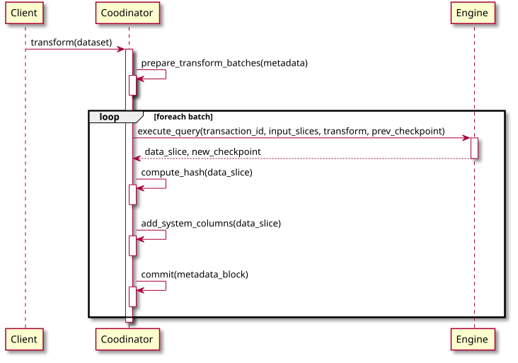

# Engine Contract <!-- omit in toc -->

**Domain**: Transformations
**Depends on**: [Data Model](../datasets/data-model.md)
**RFCs**: -

## Abstract <!-- omit in toc -->

This spec defines the contract between a [Coordinator](../glossary.md#coordinator) and an [Engine](../glossary.md#engine) - the sandboxed execution environment of engines, the communication interface and the operations engines must support, and how engine versions are pinned and deprecated to preserve reproducibility of transformations.

## Table of Contents <!-- omit in toc -->

- [Execution Model](#execution-model)
- [Communication Interface](#communication-interface)
  - [Data Exchange](#data-exchange)
- [Operations](#operations)
  - [Execute Query](#execute-query)
  - [Raw Query](#raw-query)
  - [Validate Query](#validate-query)
  - [Migrate Query](#migrate-query)
  - [Derive Provenance](#derive-provenance)
- [Engine Versioning](#engine-versioning)
- [Engine Deprecation](#engine-deprecation)
- [Message Schemas](#message-schemas)

## Execution Model
[Engine](../glossary.md#engine) executes in a very restricted environment (a "sandbox") that prevents it from accessing any external resources other than those explicitly provided by the [Coordinator](../glossary.md#coordinator). Isolating the [Engine](../glossary.md#engine) from making network calls and accessing any random files ensures both that the [Data](../glossary.md#data) being processed cannot be leaked, and that non-deterministic behavior is harder to introduce accidentally.

Our isolation technology of choice is  [OCI containers](https://opencontainers.org/) - a lightweight mechanism that provides good performance and strong isolation guarantees. We rely on OCI-compatible images as the distribution mechanism for the engines.

> **WIP:** Add exact `podman` and `docker` commands to reproduce the sandboxed environment

## Communication Interface
This section describes the [RPC](https://en.wikipedia.org/wiki/Remote_procedure_call) mechanism used in communications between the [Coordinator](../glossary.md#coordinator) and the [Engine](../glossary.md#engine).

The requirements we put towards the RPC mechanism are:
- Use common network protocols
- Wide support in many programming languages
- Support streaming responses (e.g. for streaming back the operation status and logs)

Our RPC technology of choice is [gRPC](https://grpc.io/) because:
- It's cross-platform, mature, and available in many languages
- Natively supports [FlatBuffers](https://google.github.io/flatbuffers/flatbuffers_grpc_guide_use_cpp.html) which is our [metadata format](../datasets/metadata-chain.md#metadata-format) of choice, letting us reuse object schemas
- Supports streaming
- For our narrow use case, its convenience is more important than interoperability, as we don't expect to have many server and client implementations

[Engine](../glossary.md#engine) implementations must expose the `gRPC` API on port `5544`.

Request and response messages are defined by the [message schemas](#message-schemas) and serialized using FlatBuffers. Every operation responds with a stream of messages, where zero or more `Progress` messages are followed by exactly one terminal message:
- `Success` - operation completed successfully
- `InvalidQuery` - the query did not pass validation, with a `message` explaining the error
- `InternalError` - an unexpected error occurred, with a `message` and an optional `backtrace` with details

> Note: When starting an [Engine](../glossary.md#engine) container, the [Coordinator](../glossary.md#coordinator) will consider it fully initialized when it can establish a TCP connection to the port `5544`.

### Data Exchange
The exchange of raw data happens out-of-band of the `gRPC` API.

Currently, data and checkpoints are exchanged via files and object stores. The [Coordinator](../glossary.md#coordinator) makes input data part files and the previous [Checkpoint](../glossary.md#checkpoint) available to the [Engine](../glossary.md#engine) and passes their paths in the request, along with the paths where the [Engine](../glossary.md#engine) must write the output data and the new [Checkpoint](../glossary.md#checkpoint).

In future, input and output [Data Slices](../glossary.md#data-slice) may be also exchanged using memory-mapped files (`mmap`) containing data in the common [in-memory format](../datasets/data-model.md#in-memory-and-on-disk-formats). This avoids any intermediate IO and minimizes the copying of data for the best performance.

## Operations
Engine implementation should support the following operations:
- [Execute query](#execute-query) - Performs the next iteration of the transformation.
- [Raw query](#raw-query) - Executes a query over raw data, e.g. during preprocessing of data in ingest.
- [Validate query](#validate-query) - Validates the user-specified query for basic syntax and schema correctness.
- [Migrate query](#migrate-query) - Updates the transformation state from one query to another.
- [Derive Provenance](#derive-provenance) - Explains the origin of some data produced in the past.

> **WIP:** Validate query, Migrate query, and Derive Provenance operations do not yet have defined [message schemas](#message-schemas).

### Execute Query
This operation is used by the [Coordinator](../glossary.md#coordinator) to perform the next iteration of the transformation.

The [Coordinator](../glossary.md#coordinator) is designed to isolate the [Engines](../glossary.md#engine) from the complexity of managing the [Metadata Chain](../glossary.md#metadata-chain) and make processing look as close as possible to a regular stream processing.

Inputs (`TransformRequest`):
- ID and alias of the output [Dataset](../glossary.md#dataset)
- [System Time](../glossary.md#system-time) to assign to new records
- Offset to assign to the first new record
- Vocabulary of the output [Dataset](../glossary.md#dataset) - mapping of system columns onto its schema
- Transformation [Query](../glossary.md#query)
- Inputs - for every input [Dataset](../glossary.md#dataset):
  - ID and alias of the dataset
  - Alias under which the input is referred to in the [Query](../glossary.md#query)
  - Vocabulary of the input dataset
  - Offset interval of the input [Data Slice](../glossary.md#data-slice) that goes into this transaction
  - Schema and data files of the input
  - Explicit [Watermarks](../glossary.md#watermark) that should be injected into the stream to separate micro-batches for reproducibility
- Previous [Checkpoint](../glossary.md#checkpoint)
- Locations where new data and the new [Checkpoint](../glossary.md#checkpoint) should be written

Outputs (`TransformResponse`):
- Offset interval of the output [Data Slice](../glossary.md#data-slice), if any data was produced
- Output [Watermark](../glossary.md#watermark), if it was advanced
- New [Checkpoint](../glossary.md#checkpoint)
- Operation progress and status

This operation must be [idempotent](https://en.wikipedia.org/wiki/Idempotence).

When an operation is committed by the [Coordinator](../glossary.md#coordinator), the [Engine](../glossary.md#engine) will not see the same input data again. If due to the nature of the query (e.g. windowing or watermarking configuration) [Engine](../glossary.md#engine) cannot fully process and discard the input data - it should use the [Checkpoint](../glossary.md#checkpoint) to buffer it.

### Raw Query
This operation is used by the [Coordinator](../glossary.md#coordinator) to execute a [Query](../glossary.md#query) over raw data that is not yet part of any dataset, e.g. during the preprocessing step of [Ingestion](../glossary.md#ingestion).

Inputs (`RawQueryRequest`):
- Input data files to perform the query over - all files must have identical schema
- Transformation [Query](../glossary.md#query)
- Location where the query result should be written

Outputs (`RawQueryResponse`):
- Number of records produced by the query
- Operation progress and status

### Validate Query
This operation may be used by the [Coordinator](../glossary.md#coordinator) when creating a new [Derivative Dataset](../glossary.md#derivative-dataset) or when changing the [Query](../glossary.md#query) of an existing one to validate the user-specified query for basic syntax and schema correctness.

Inputs:
- [Schemas](../glossary.md#schema) of the input [Datasets](../glossary.md#dataset)
- [Query](../glossary.md#query)
- (optional) Previous [Query](../glossary.md#query) in case of an existing [Dataset](../glossary.md#dataset) modification

Outputs:
- [Schema](../glossary.md#schema) of the result
- (alternatively) Validation errors

### Migrate Query
This operation is used by the [Coordinator](../glossary.md#coordinator) when data processing hits the point where one transformation [Query](../glossary.md#query) is being replaced by another one. It gives the [Engine](../glossary.md#engine) all information needed to handle the transition as gracefully as possible, e.g. by reconciling the existing [Checkpoints](../glossary.md#checkpoint) with the new [Query](../glossary.md#query), or, at the very least, finalizing the processing of the old [Query](../glossary.md#query) and clearing the [Checkpoints](../glossary.md#checkpoint) before the new one starts to execute.

Inputs:
- Transaction ID
- Previous [Query](../glossary.md#query)
- Next [Query](../glossary.md#query)
- Previous [Checkpoint](../glossary.md#checkpoint)

Outputs:
- New [Checkpoint](../glossary.md#checkpoint)
- (optional) [Data](../glossary.md#data) that has been produced when finalizing the old [Query](../glossary.md#query)

### Derive Provenance
This operation is used to trace back a set of events in the output [Dataset](../glossary.md#dataset) to input events that contributed to their values or their existence (see [Provenance](../glossary.md#provenance)).

> **WIP:** The design of this operation is in progress.

## Engine Versioning
As described in [Components of Trust](../overview.md#components-of-trust), to guarantee the reproducibility and verifiability of the results a transformation must be associated with an exact version of an [Engine](../glossary.md#engine) that is used to perform it. We want to exclude any possibility that the code changes in the [Engine](../glossary.md#engine) will break this guarantee.

Whenever the [Coordinator](../glossary.md#coordinator) uses an [Engine](../glossary.md#engine) to execute a query it must specify the full digest of the OCI container image in the resulting [Metadata Block](../glossary.md#metadata-chain). [Engine](../glossary.md#engine) maintainers are therefore responsible for treating the images as immutable and ensure old versions are never lost.

See also:
- [Engine Deprecation](#engine-deprecation)

## Engine Deprecation
Pinning the exact [Engine](../glossary.md#engine) version used by every transformation guarantees the reproducibility and verifiability of the results (see [Components of Trust](../overview.md#components-of-trust)). In the long run, however, this creates a problem where in order to [validate a dataset](processing-model.md#validation) the [Coordinator](../glossary.md#coordinator) will have to use a very large number of different versions of an [Engine](../glossary.md#engine) that might've accumulated over the years. This slows down the validation procedure and can result in a significant disk space required for storing these images.

To mitigate this problem the [Coordinator](../glossary.md#coordinator) offers the **engine deprecation** operation that works as follows:
1. The [Coordinator](../glossary.md#coordinator) reconstructs the dataset from scratch by repeating all transformation in the [Metadata Chain](../glossary.md#metadata-chain).
2. Instead of the [Engine](../glossary.md#engine) version specified in the block, it uses the latest (or provided) version.
3. If the results produced in every step match the recorded ones - we can safely consider that the newer version of the [Engine](../glossary.md#engine) is fully compatible with the older one.
4. A special [Metadata](../glossary.md#metadata-chain) record is created to record this compatibility, therefore, allowing all users to use the latest version of the [Engine](../glossary.md#engine) instead of downloading all the versions seen previously.

## Message Schemas
Messages exchanged between the [Coordinator](../glossary.md#coordinator) and the [Engine](../glossary.md#engine) are defined by the following schemas:

| Schema | Description |
| --- | --- |
| [`TransformRequest`](../../schemas/engines/v1alpha1/TransformRequest.json) | Sent by the coordinator to perform the next step of data transformation |
| [`TransformRequestInput`](../../schemas/engines/v1alpha1/TransformRequestInput.json) | Describes an input of the transform request |
| [`TransformResponse`](../../schemas/engines/v1alpha1/TransformResponse.json) | Sent by the engine when performing the data transformation |
| [`RawQueryRequest`](../../schemas/engines/v1alpha1/RawQueryRequest.json) | Sent by the coordinator to perform a query on raw input data |
| [`RawQueryResponse`](../../schemas/engines/v1alpha1/RawQueryResponse.json) | Sent by the engine when performing the raw query |
