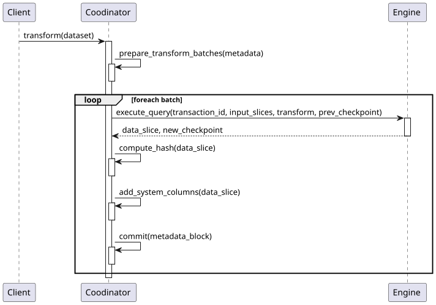

# Processing Model <!-- omit in toc -->

**Domain**: Transformations\
**Depends on**: [Data Model](../datasets/data-model.md), [Metadata Chain](../datasets/metadata-chain.md), [Engine Contract](engine-contract.md)\
**RFCs**: [RFC-015](../../rfcs/015-unified-changelog-stream-schema.md)


## Abstract <!-- omit in toc -->

This spec defines how data of [Derivative Datasets](../glossary.md#derivative-dataset) is produced from their inputs. It describes how derivative datasets are defined, how [Event Time](../glossary.md#event-time), [Watermarks](../glossary.md#watermark), and [Checkpoints](../glossary.md#checkpoint) are used to process potentially infinite event streams incrementally with exactly-once semantics, the steps a [Coordinator](../glossary.md#coordinator) performs during a transformation, and how transformation queries can evolve over time.


## Table of Contents <!-- omit in toc -->

- [Derivative Datasets](#derivative-datasets)
  - [Derivative Data Transience](#derivative-data-transience)
- [Time and Watermarks](#time-and-watermarks)
- [Retractions and Corrections](#retractions-and-corrections)
- [Checkpoints](#checkpoints)
- [Derivative Transformations](#derivative-transformations)
- [Verification](#verification)
  - [Verification via Reproducibility](#verification-via-reproducibility)
  - [Verification via Verifiable Computing](#verification-via-verifiable-computing)
  - [Asynchronous Verification](#asynchronous-verification)
- [Dataset Evolution](#dataset-evolution)
  - [Query Evolution](#query-evolution)
- [Provenance](#provenance)


## Derivative Datasets
All transformations in ODF follow the stream processing model (see [Stream Processing Model](../overview.md#stream-processing-model)).

A [Derivative Dataset](../glossary.md#derivative-dataset) is defined by the [`SetTransform`](../../schemas/datasets/v1alpha1/SetTransform.json) event in its [Metadata Chain](../datasets/metadata-chain.md), which specifies:
- `inputs` ([`TransformInput`](../../schemas/datasets/v1alpha1/TransformInput.json)) - the input datasets, each with an `alias` under which it is available in queries (see [Identity: References in Metadata](../datasets/identity.md#references-in-metadata))
- `transform` ([`Transform`](../../schemas/datasets/v1alpha1/Transform.json)) - the [Query](../glossary.md#query), the [Engine](../glossary.md#engine) that executes it, and the engine version

```yaml
kind: SetTransform
inputs:
  - datasetRef: sensor.temp
transform:
  kind: Sql
  engine: flink
  query: |
    SELECT
      TUMBLE_START(event_time, INTERVAL '1' HOUR) as event_time,
      min(value) as value_min,
      max(value) as value_max
    FROM `sensor.temp`
    GROUP BY TUMBLE(event_time, INTERVAL '1' HOUR)
```

Queries can consist of multiple steps, where every step acts as a shorthand for `CREATE TEMPORARY VIEW <alias> AS (<query>)` and the last step produces the output. When stored in the metadata, a single `query` is always converted into the `queries` array.

Every execution of the transformation is recorded in the chain as an [`ExecuteTransform`](../../schemas/datasets/v1alpha1/ExecuteTransform.json) event that captures the exact intervals of input blocks and records that were processed, and the resulting data, checkpoint, and watermark (see [Metadata Chain: Offsets and Intervals](../datasets/metadata-chain.md#offsets-and-intervals)).


### Derivative Data Transience
Since past data in the input datasets is immutable and all transformations are required to be deterministic - derivative datasets are **functionally dependent** on their inputs. This means that for any given transformation graph it is possible to fully reconstruct data of all derivative datasets from the data of root datasets by simply re-applying all transformations.

> Data in derivative datasets can be considered a **form of caching** and does not require durable storage.


## Time and Watermarks
Following the [bitemporal](../glossary.md#time) data model, all records carry the [System Time](../glossary.md#system-time) when they were observed by the system, and the [Event Time](../glossary.md#event-time) when they occurred from the perspective of the outside world. Transformations operate primarily in event time.

When performing time-based windowed operations, aggregations, or joins it is important to know when a certain time window can be considered closed. Every `AddData` and `ExecuteTransform` event can carry a new [Watermark](../glossary.md#watermark) of the dataset - the point in event time for which all preceding events have most likely been observed:
- In [Root Datasets](../glossary.md#root-dataset) watermarks are advanced during ingestion, and can also be advanced without adding new data, e.g. for slow-moving datasets where it is normal not to see any events for a long time
- In derivative datasets, watermarks of the inputs are passed into the [Engine](../glossary.md#engine) along with the data (see [Engine Contract: Execute Query](engine-contract.md#execute-query)), and the engine determines the output watermark

Watermarks are monotonically non-decreasing. Events that arrive after their time interval was closed by the watermark are considered "late", and it's up to individual queries to decide how to handle them - ignore them, emit them into a side output, or emit [corrections](../glossary.md#retractions-and-corrections) into the output.


## Retractions and Corrections
Data of all datasets is a changelog stream that can contain [retractions and corrections](../glossary.md#retractions-and-corrections) of previously published events (see [Data Model](../datasets/data-model.md#representation-of-retractions-and-corrections)). Transformations must take them into account:
- **Retractions and corrections in the inputs** must be propagated - a transformation must update its previously produced results that were influenced by the retracted or corrected input events, by emitting retractions or corrections into the output
- **Late events** in the inputs can similarly cause a transformation to retract or correct its previously produced results (see [Time and Watermarks](#time-and-watermarks))
- **The nature of the query** itself may require it to revise its results as new events arrive, even when the inputs contain only appends

This makes all derivative datasets self-correcting - a correction issued in a root dataset propagates through the entire graph of transformations without any manual intervention.

For example, consider a `match_scores` dataset that receives events as players complete the matches:

| op | match_time | match_id | player_name | score |
| --- | --- | --- | --- | --- |
| +A | t1 | 1 | Alice | 100 |
| +A | t1 | 1 | Bob | 80 |
| +A | t2 | 2 | Alice | 70 |
| +A | t2 | 2 | Charlie | 90 |
| +A | t3 | 3 | Bob | 60 |
| +A | t3 | 3 | Charlie | 110 |

A derivative dataset that continuously tracks the two highest-scoring players (a leader board) can be defined using a Top-N query:

```sql
select *
from (
  select
    row_number() over (order by score desc) as place,
    match_time,
    player_name,
    score
  from match_scores
) where place <= 2
```

Even though the input contains only appends, the leader board changes as new scores arrive, so the output contains corrections:

| op | place | match_time | player_name | score |
| --- | --- | --- | --- | --- |
| +A | 1 | t1 | Alice | 100 |
| +A | 2 | t1 | Bob | 80 |
| -C | 2 | t1 | Bob | 80 |
| +C | 2 | t2 | Charlie | 90 |
| -C | 1 | t1 | Alice | 100 |
| +C | 1 | t3 | Charlie | 110 |
| -C | 2 | t2 | Charlie | 90 |
| +C | 2 | t1 | Alice | 100 |

If the source later retracted the result of the first match, the leader board would in turn issue retractions and corrections of the affected places.

[Engines](../glossary.md#engine) are responsible for implementing these semantics and producing valid changelog streams (see [Engine Contract: Execute Query](engine-contract.md#execute-query)).


## Checkpoints
Engines store the computation state between different invocations of a query in [Checkpoints](../glossary.md#checkpoint). Checkpoints are fully engine-specific and opaque to the system, but they are an essential durable part of a dataset, necessary to pause and resume streaming queries.

Every transaction restores the state from the checkpoint referenced by `prevCheckpoint` and records the new checkpoint in `newCheckpoint` of the `ExecuteTransform` event, atomically with the output data. Together with the exact intervals of processed inputs, this provides **exactly-once** processing semantics - every input record contributes to the output exactly once, even if the transformation is interrupted and resumed.

Checkpoints are hashed and stored as described in [Data & Checkpoint Hashing](../datasets/data-and-checkpoint-hashing.md#checkpoint-hashing) and [Storage Layout](../datasets/storage-layout.md#checkpoints).


## Derivative Transformations
The [Engine Contract](engine-contract.md#execute-query) describes how an [Engine](../glossary.md#engine) executes the transformation query. This section describes what happens on the [Coordinator](../glossary.md#coordinator) side.



Here are the steps that the [Coordinator](../glossary.md#coordinator) performs during the transformation:
- **Batch step** - Analyze the [Metadata Chains](../glossary.md#metadata-chain) of the [Dataset](../glossary.md#dataset) being transformed and all the inputs. The goal here is to decide how far the processing can progress before hitting one of the special conditions, such as a change of schema in one of the inputs or a change of the transformation query.
- **Run migrations** (when needed) - If a special condition is encountered - call the [Engine's](../glossary.md#engine) [Migrate Query](engine-contract.md#migrate-query) operation to make necessary adjustments for the new transformation parameters.
- **Run query** - Pass the input [Data Slices](../glossary.md#data-slice) into the [Engine's](../glossary.md#engine) [Execute Query](engine-contract.md#execute-query) operation
- **Hash resulting data and checkpoint** - Obtain a stable [Hash](../glossary.md#hash) of the output [Data Slice](../glossary.md#data-slice) and [Checkpoint](../glossary.md#checkpoint) (see [Data Hashing](../datasets/data-and-checkpoint-hashing.md#physical-vs-logical-hashes) and [Checkpoint Hashing](../datasets/data-and-checkpoint-hashing.md#checkpoint-hashing))
- **Prepare commit** - Creates the next [Metadata Block](../glossary.md#metadata-chain) describing the output data
- **Commit** - Atomically adds the new [Data Slice](../glossary.md#data-slice) and the [Metadata Block](../glossary.md#metadata-chain) to the [Dataset](../glossary.md#dataset)


## Verification
The verification of a [Derivative Dataset](../glossary.md#derivative-dataset) confirms that its data is in fact produced by applying all the transformations stored in its [Metadata Chain](../datasets/metadata-chain.md) to the inputs and was not maliciously altered.

Verification is **recursive**: data of a derivative dataset can only be as valid as the data of its inputs, so fully verifying it involves verifying all datasets in its lineage, up to the [Root Datasets](../glossary.md#root-dataset) (see [Ingestion: Validity of Root Data](../datasets/ingestion.md#validity-of-root-data)). Since every `ExecuteTransform` event records the exact blocks of the inputs it was applied to, each input is verified at the specific state that was used, regardless of how it has evolved since.

Verification does not prove that the declared transformations are correct or benign - only that they were applied faithfully. Transformations are expressed as [Queries](../glossary.md#query) that are usually small, so they can be audited to ensure they are sound and done in good faith. Establishing trust in a derivative dataset therefore combines inspecting its lineage, auditing the transformations along the way, and verifying that its data matches them.


### Verification via Reproducibility
Reproducing transformations is conceptually the simplest way of verifying derivative data. The process is almost identical to the [Derivative Transformation](#derivative-transformations), except instead of the `Commit` step the [Coordinator](../glossary.md#coordinator) compares the hashes of the data produced by the local transformation to the hashes stored in the `ExecuteTransform` events, using the exact versions of engines recorded in the metadata.

Due to non-determinism of the Parquet format the physical hash may not match the one in metadata, so a fallback to the logical hash is required to verify that the resulting records are logically the same (see [Data & Checkpoint Hashing: Validation and Verification](../datasets/data-and-checkpoint-hashing.md#validation-and-verification)).

Reproducing transformations is necessary even when hashes of data match the ones in metadata. Hash checks only ensure that data was not tampered with or corrupted, but data and metadata could have been replaced together. Reproducing the transformations ensures that the data in fact corresponds to the declared transformations, so metadata cannot be spoofed to match fake results.

This form of verification requires access to all input data and the compute resources to repeat the processing.


### Verification via Verifiable Computing
ODF aims to also support forms of verifiable computing that allow verifying results without repeating the transformations, such as attestations from [Trusted Execution Environments](https://en.wikipedia.org/wiki/Trusted_execution_environment) (TEEs) and [zero-knowledge proofs](https://en.wikipedia.org/wiki/Zero-knowledge_proof) (ZKPs). In this model the party performing the transformation produces a proof that the declared transformation was applied faithfully to the specific inputs, which others can check at a fraction of the cost of repeating the computation.

Since verifying such proofs does not require access to the input data, verifiable computing can also **preserve privacy** - derivative data can be verified without disclosing the potentially sensitive data it was produced from to the verifying parties.


### Asynchronous Verification
Verification does not have to happen synchronously with updates of data. Since every `ExecuteTransform` event captures the exact intervals of inputs it processed, verifiers can proceed incrementally and asynchronously from the last verified block - e.g. a dataset may already be on block `T` while verifiers are still checking processing block `T - 100`, aiming to eventually catch up. This allows participants to use data optimistically, while preserving the ability to detect and dispute invalid data later. Clients can define verification thresholds, e.g. requiring N verifiers to check the block before it is consumed.


## Dataset Evolution
Most parts of the [Dataset](../glossary.md#dataset) can [change over time](../datasets/logical-structure.md#evolution-of-data). To protect downstream consumers of data from breaking changes the [Coordinator](../glossary.md#coordinator) has to validate the changes for backward compatibility before accepting them. This section covers the allowed transitions for different parts of the [Metadata](../glossary.md#metadata-chain).


### Query Evolution
The procedure for modifying the [Query](../glossary.md#query) of a [Derivative Dataset](../glossary.md#derivative-dataset) is as following:
1. The [Coordinator](../glossary.md#coordinator) invokes the [Engine's](../glossary.md#engine) [Validate Query](engine-contract.md#validate-query) operation to validate the new [Query](../glossary.md#query) and determine the validity of the transition according to the engine-specific rules.
2. The new [Schema](../glossary.md#schema) returned in the previous step is validated according to the [Schema Evolution](../datasets/data-model.md#schema-evolution) rules.
3. A new [Metadata Block](../glossary.md#metadata-chain) is created and committed.


## Provenance
Since the [Engines](../glossary.md#engine) are responsible for all data transformations, it's also the engine's responsibility to answer [Provenance](../glossary.md#provenance) queries, i.e. to explain which input data elements an output element was derived from and how. Provenance is derived using the [Derive Provenance](engine-contract.md#derive-provenance) operation of the engine.
